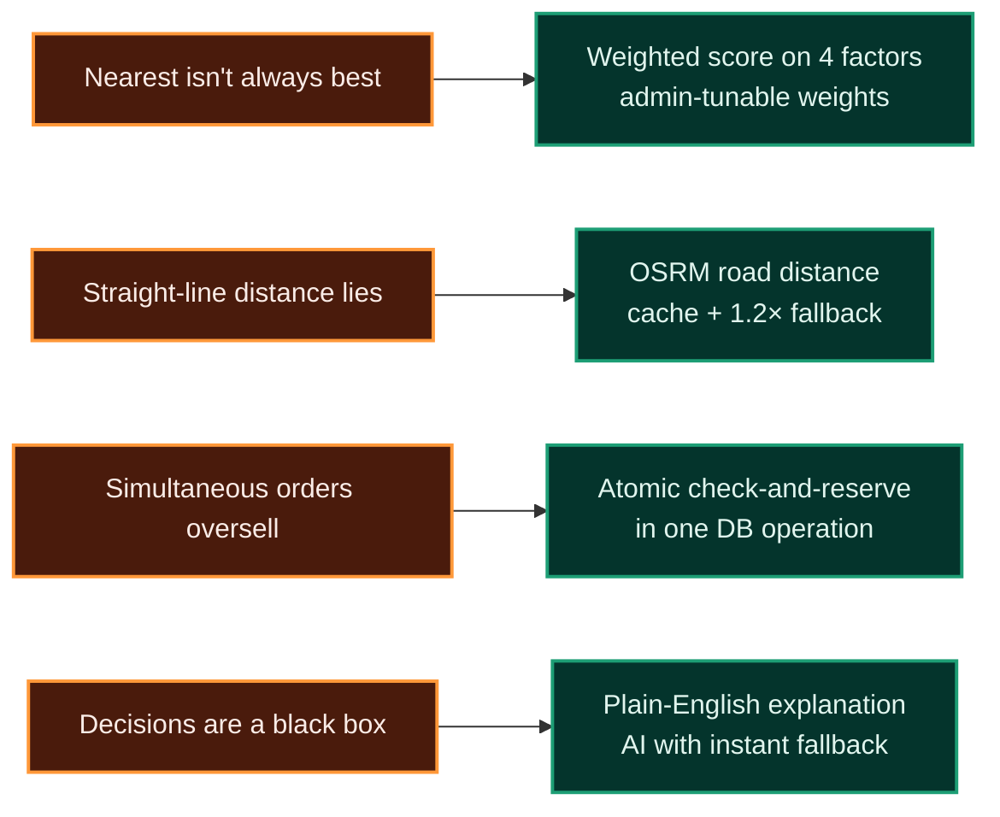
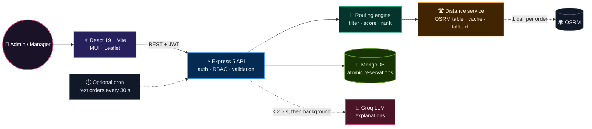
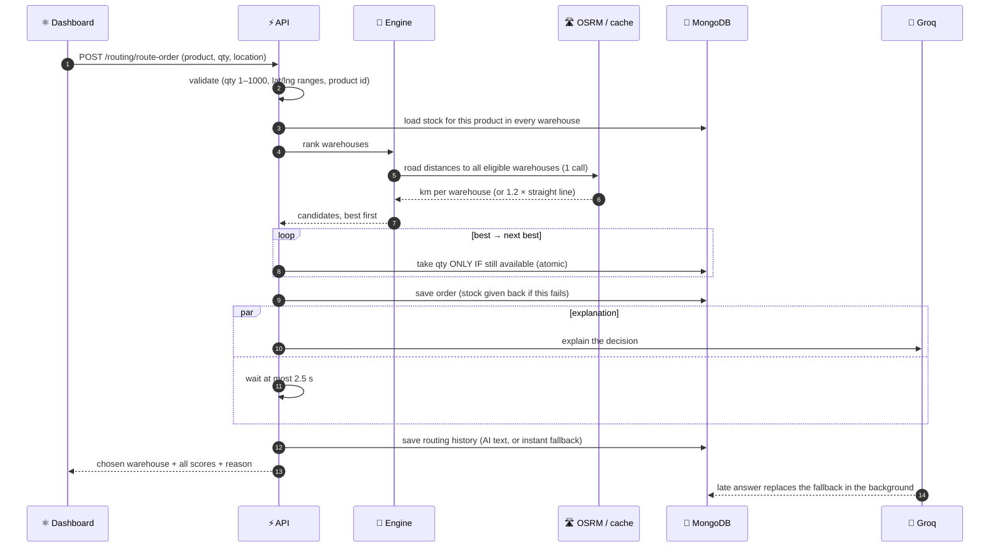
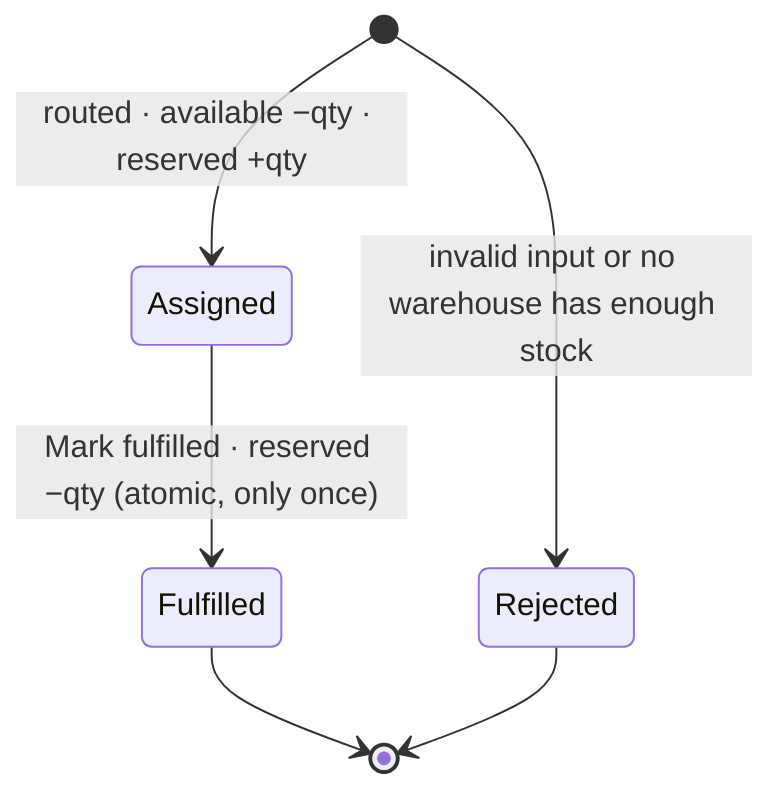

<div align="center">


<br/>


<br/>


<br/><br/>

<a href="#numbers">📊 Numbers</a> •
<a href="#algorithm">🧮 Algorithm</a> •
<a href="#architecture">🏗️ Architecture</a> •
<a href="#concurrency">🔒 Concurrency</a> •
<a href="#work">🛠️ Work done</a> •
<a href="#benchmarks">📈 Benchmarks</a> •
<a href="#tradeoffs">⚖️ Trade-offs</a> •
<a href="#interview">🧠 Interview</a> •
<a href="#run">🚀 Run it</a>

</div>


<div align="center">

</div>

> **TL;DR** — When an order arrives, the engine **validates** it, **filters** warehouses that are inactive or out of stock, gets **real road distances** in one OSRM call (cached, with a measured fallback), **scores** every candidate on distance, stock, delivery time and cost, **reserves stock atomically** so two orders can never buy the same units, and stores a **plain-English explanation** of the decision — without ever making the customer wait for the AI.

<a id="numbers"></a>

## 📊 By the numbers

<div align="center">


<br/>


<br/>


</div>

| Metric | Value | How it was measured |
| :-- | :-- | :-- |
| Concurrent safety | **20** simultaneous orders on **5** units → **exactly 5** succeed, stock never negative | `scripts/race-test.js` (real MongoDB, in-memory) |
| Core engine latency | **p50 5.4 ms · p95 15.1 ms** per order (sequential) | `scripts/benchmark.js`, map API and LLM switched off |
| Core engine throughput | **327 orders/s** at concurrency 10 · **352 orders/s** at 50 | same benchmark, on a laptop |
| Road vs straight line | road is **1.20×** longer on average (max **1.99×**) | `scripts/roadcheck.js`, 60 customers × 5 warehouses |
| Distance cache | OSRM **p50 229 ms / p95 483 ms** vs cache **0.028 ms** | same script |
| AI explanation | the order waits **≤ 2.5 s**; slower answers are saved later in the background | `orderService.js` |
| Engine vs "nearest warehouse" | default weights **₹2,406** vs nearest **₹2,429** average shipping cost | `scripts/simulate.js`, 300 orders × 20 runs |


## 🎯 The problem

A product is stocked in several warehouses. For each incoming order, **which warehouse should ship it?**

- The **nearest** one may be nearly out of stock, slow to dispatch, or expensive per km.
- The **cheapest** one may be far away and slow.
- Two orders arriving **at the same moment** must never both get the last unit.
- Operations staff need to understand **why** a warehouse was chosen.

## 💡 The approach



## ✨ Features

| | Feature | Admin | Manager |
| :-: | :-- | :-: | :-: |
| 📊 | **Dashboard** — warehouse, product and order counts | ✅ | — |
| 🏭 | **Warehouses** — location, capacity, dispatch time, cost/km, speed | ✅ | — |
| 📦 | **Inventory** — per-warehouse stock, low-stock badges, edit stock | ✅ | ✅ |
| 🛒 | **Orders** — route an order, auto-generate test orders, mark fulfilled | ✅ | fulfil only |
| 🧭 | **Routing decision** — every candidate's scores, the winner highlighted, the explanation | ✅ | ✅ |
| 🕒 | **Routing history** — paginated, searchable by customer or warehouse | ✅ | ✅ |
| 🗺️ | **Map** — warehouses and orders on a Leaflet map | ✅ | ✅ |
| ⚙️ | **Routing settings** — tune the 4 weights (must total 100) | ✅ | — |

<a id="architecture"></a>

## 🏗️ Architecture



### 🔄 One order, end to end



### 📦 Order and stock lifecycle




<a id="algorithm"></a>

## 🧮 The algorithm

### 1️⃣ Filter

A warehouse is **eliminated** if it's inactive or has fewer units available than the order needs. Eliminated warehouses are stored with the reason, so the UI can show *why* they lost.

### 2️⃣ Raw score per factor (higher = better)

For each eligible warehouse, with road distance $d$ (km), available stock $s$, speed $v$ (km/day), dispatch time $h$ (hours) and rate $c$ (₹/km):

$$D_{raw} = \frac{1}{1+d} \qquad I_{raw} = s \qquad T = \frac{d}{v} + \frac{h}{24},\;\; T_{raw} = \frac{1}{T} \qquad C = d \cdot c,\;\; C_{raw} = \frac{1}{1+C}$$

| Factor | Meaning | Why this form |
| :-- | :-- | :-- |
| 🟦 **Distance** $D$ | closer is better | $1/(1+d)$ never divides by zero |
| 🟩 **Stock** $I$ | more units on the shelf is better | absolute stock, so a nearly empty warehouse can't look "healthy" |
| 🟧 **Delivery** $T$ | days to deliver = travel + dispatch | uses each warehouse's own speed and dispatch time |
| 🟥 **Cost** $C$ | shipping cost = km × rate | uses each warehouse's own ₹/km |

### 3️⃣ Min-max normalization (put km, units, days and ₹ on one 0–1 scale)

$$x' = \begin{cases} \dfrac{x - x_{\min}}{x_{\max} - x_{\min}} & \text{if } x_{\max} \neq x_{\min} \\[6pt] 1 & \text{if every candidate ties} \end{cases}$$

### 4️⃣ Weighted final score (weights are admin-editable, each 0–100, total 100)

$$S = w_D\,D' + w_I\,I' + w_T\,T' + w_C\,C' \qquad \text{default } (w_D, w_I, w_T, w_C) = (0.35,\ 0.35,\ 0.20,\ 0.10)$$

Candidates are sorted by $S$. The best one is tried first; if another order took its stock a millisecond earlier, the next one is tried.

### 🧪 Worked example — 6 laptops to Ranchi

Mumbai is **eliminated** (only 5 units). The other four are scored (distances here use the straight-line × 1.2 estimate):

| Rank | Warehouse | Road km | Delivery days | Cost ₹ | Stock | $D'$ | $I'$ | $T'$ | $C'$ | **Score** |
| :-: | :-- | --: | --: | --: | --: | :-: | :-: | :-: | :-: | :-: |
| 🥇 | **Delhi** | 1,216 | 7.08 | 8,511 | 15 | 0.87 | 0.14 | 0.93 | **1.00** | **0.640** |
| 🥈 | Hyderabad | **1,166** | **6.89** | 9,328 | 12 | **1.00** | 0.00 | **1.00** | 0.77 | 0.627 |
| 🥉 | Bangalore | 1,694 | 10.91 | 10,163 | **33** | 0.00 | **1.00** | 0.07 | 0.57 | 0.421 |
| 4 | Chennai | 1,510 | 11.44 | 13,593 | 20 | 0.27 | 0.38 | 0.00 | 0.00 | 0.227 |

> **Why Delhi beats the nearest warehouse:** Hyderabad is 50 km closer and slightly faster, but Delhi ships at ₹7/km instead of ₹8/km (≈ ₹800 cheaper here) and has more stock. The weighted score captures that trade-off; "pick the nearest" can't.

### 🛣️ Distance service

- **One OSRM Table API call** returns road distances from the customer to *all* eligible warehouses (not one call per warehouse).
- **Cache:** key = customer location rounded to 2 decimals (~1 km grid) + warehouse ids · TTL **24 h** · up to **5,000** entries.
- **Timeout 2.5 s → fallback** to the Haversine straight line × **1.2** (the detour factor measured across 60 customers):

$$d_{straight} = 2R \arcsin \sqrt{\sin^2\tfrac{\Delta\varphi}{2} + \cos\varphi_1 \cos\varphi_2 \sin^2\tfrac{\Delta\lambda}{2}}, \qquad R = 6371\ \text{km}, \qquad d_{fallback} = 1.2 \cdot d_{straight}$$

The UI marks estimated distances with **≈**, so users know when a number is an estimate.

<a id="concurrency"></a>

## 🔒 Concurrency: no overselling

**The bug that existed:** reserving stock was *read → check → write*. Two orders arriving together both read "5 left", both passed the check, both saved — **20 orders were accepted for 5 units**.

**The fix:** check and take in **one atomic operation**. MongoDB guarantees a single-document update can't be interrupted.

```js
const reserved = await Inventory.findOneAndUpdate(
  { _id: candidate.inv._id, availableQuantity: { $gte: quantity } },          // only if still enough
  { $inc: { availableQuantity: -quantity, reservedQuantity: quantity } },       // ...take it
  { returnDocument: 'after' }
);
if (!reserved) { /* someone else got it first → try the next-best warehouse */ }
```

The same idea protects **fulfilment**: an order flips `assigned → fulfilled` with a filter on `status: 'assigned'`, so a double click can't release reserved stock twice (the second request gets **409**).

<details>
<summary>🧪 <b>Proof — race test output</b></summary>

<br/>

```text
Stock: 5 units. Firing 20 orders at the same time...
Orders that succeeded : 5
Stock left            : available 0, reserved 5
✅ PASS — no overselling
```
Run it yourself: `cd server && node scripts/race-test.js`
</details>

## 🤖 Explanations without the wait

```text
aiPromise   = Groq.explain(decision)          // 8 s timeout, 1 retry
winner      = race(aiPromise, 2.5 s timer)
reason      = winner ?? templateExplanation()  // instant, built from the scores
save(history with reason)
if AI was late: aiPromise.then(text → update history in the background)
```

The routing decision is pure math; the AI only *explains* it. So the customer never waits more than 2.5 s for a nice-to-have, and an LLM outage never blocks orders.


<a id="work"></a>

## 🛠️ Real work done

Problems found by auditing the code, fixed and tested:

| # | Area | 🔴 Before | 🟢 After |
| :-: | :-- | :-- | :-- |
| 1 | **Overselling** | read-check-write: 20 orders accepted for 5 units | atomic conditional update + next-best fallback; race test passes |
| 2 | **Self-made admins** | sign-up accepted any role (defaulted to *admin*) | sign-up always creates a manager; role read from the DB on login |
| 3 | **Negative quantity** | quantity −5 **added** 5 units | validated 1–1000 whole number, lat/lng ranges, product id → 400 |
| 4 | **Mass assignment** | updates saved the whole request body | allow-listed fields per endpoint |
| 5 | **JWT secret** | public fallback string in code | server refuses to start without a 32+ char secret |
| 6 | **DB TLS** | certificate checks disabled | re-enabled |
| 7 | **Reserved stock** | never released | released atomically on fulfilment; double fulfil → 409 |
| 8 | **AI latency** | every order waited for the LLM | capped at 2.5 s with instant fallback, upgraded later |
| 9 | **Unbounded lists** | all orders/history returned at once | pagination + server-side search + indexes |
| 10 | **Inventory score** | ratio: 2 units scored better than 900 | absolute stock |
| 11 | **Warehouse data** | speed 0 → infinite delivery time; negative cost | schema ranges (speed 1–2,000, cost ≥ 0, lat/lng) |
| 12 | **Routing weights** | 150 + (−50) + 0 + 0 accepted | each weight 0–100 and total 100 |
| 13 | **Dashboard stats** | `/orders/stats` swallowed by `/:id` route → 500 | static route before parameter route; bad ids → 404 |
| 14 | **Out-of-stock orders** | crashed with a 500 | clear "no eligible warehouse" response |
| 15 | **Measurement scripts** | crashed (wrong paths) | race test, benchmark, simulation, road check all run |

<a id="benchmarks"></a>

## 📈 Benchmarks & simulation

<details open>
<summary>⚡ <b>Throughput and latency</b> — <code>node scripts/benchmark.js</code></summary>

<br/>

| Load | Result |
| :-- | :-- |
| 500 orders, one after another | p50 **5.4 ms**, p95 **15.1 ms** |
| 1,000 orders, 10 in parallel | **327 orders/s** (p95 41.7 ms) |
| 1,000 orders, 50 in parallel | **352 orders/s** (p95 183.5 ms) |

*Measured on a laptop with an in-memory MongoDB, with OSRM and the LLM switched off: this is the cost of validation + scoring + atomic reservation. In production the external calls dominate, which is why distances are cached and the AI is off the critical path.*
</details>

<details open>
<summary>🧭 <b>Policy comparison</b> — <code>node scripts/simulate.js</code> (300 orders × 20 runs)</summary>

<br/>

| Policy | Avg shipping cost | Avg delivery days | Stock-use spread |
| :-- | --: | --: | --: |
| Nearest warehouse (baseline) | ₹2,429 | 2.67 | 31.2 % |
| **Default 35 / 35 / 20 / 10** | **₹2,406** | **2.66** | 31.0 % |
| Speed-first 10 / 10 / 70 / 10 | ₹2,424 | 2.67 | 31.3 % |
| Cost-first 10 / 10 / 10 / 70 | ₹2,652 | 2.94 | 31.7 % |
| Balance-stock 10 / 70 / 10 / 10 | ₹5,185 | 5.10 | **7.9 %** |

**Honest reading:** the default weights are about **1 % cheaper** than "nearest" (it was 0.3 % before the inventory-score fix). Balance-stock spreads stock evenly (7.9 % vs 31 %) but doubles cost. **Cost-first is *worse* on cost** because routing is greedy — one order at a time, it spends a cheap warehouse's stock on far customers, and nearby customers later ship from far away. See [trade-offs](#tradeoffs).
</details>

<details>
<summary>🛣️ <b>Road distance check</b> — <code>node scripts/roadcheck.js</code></summary>

<br/>

| Measure | Value |
| :-- | :-- |
| Routes tested | 60 customers × 5 warehouses |
| Road ÷ straight line | avg **1.20×**, median 1.20×, max 1.99× |
| Nearest warehouse changed by using road distance | **0 / 60** |
| OSRM latency | p50 229 ms · p95 483 ms |
| Cached lookup | p50 0.028 ms |

Road distance mostly matters for **accurate cost and delivery time**, not for which warehouse is closest.
</details>


<a id="tradeoffs"></a>

## ⚖️ Trade-offs

| 🟢 Chose | ⚪ Over | ✅ Gained | ⚠️ Gave up |
| :-- | :-- | :-- | :-- |
| **Weighted scoring** | nearest warehouse | configurable, explainable trade-offs | only ~1 % cheaper by default (greedy) |
| **Greedy, per order** | batch optimization (min-cost flow) | real-time, O(warehouses) per order | can spend stock that a later, closer order needed |
| **Min-max normalization** | fixed-scale normalization | units, km, days and ₹ on one scale | relative: tiny gaps between 2 candidates become 0 vs 1 |
| **Atomic `findOneAndUpdate`** | multi-document transactions | simple, fast, no replica-set dependency for correctness | order + history writes aren't one transaction (compensated manually) |
| **MongoDB** | PostgreSQL | nested routing history (all scores) fits naturally | inventory is relational; row locks would be the SQL way |
| **OSRM + cache + 1.2× fallback** | straight line only | real road cost and ETA, still works if OSRM is down | public OSRM is rate-limited; cache is per process |
| **AI explanation with 2.5 s cap** | blocking LLM call | orders never wait on the LLM | explanation can arrive a bit later |
| **JWT (8 h) in localStorage** | server sessions / httpOnly cookies | stateless, simple | readable by XSS; can't be revoked before expiry |
| **Cron inside the API** | separate worker | zero extra infrastructure | duplicates if the API is scaled to 2+ instances |

<details>
<summary>🚧 <b>Known limitations (honest)</b></summary>

<br/>

- **Greedy routing** — each order is decided alone; batch optimization would lower total cost.
- **Min-max normalization** exaggerates tiny differences between two candidates.
- **Correlated factors** — distance, delivery and cost all depend on distance, so ~65 % of the default weight is distance-driven.
- **Single product per order**, no split shipments across warehouses.
- **In-process distance cache** — not shared between server instances.
- **Public OSRM server** — fine for demos; production should self-host.
- **No rate limiting** on login or routing endpoints yet.
</details>

<a id="interview"></a>

## 🧠 Interview corner

<details>
<summary>❓ <b>What happens if two orders hit the same stock at the same moment?</b></summary>

<br/>Both used to succeed. Now reservation is one conditional atomic update — "take *q* only if *available ≥ q*". Exactly one wins; the loser falls back to the next-best warehouse or gets "out of stock". I proved it with a test that fires 20 concurrent orders at 5 units.
</details>

<details>
<summary>❓ <b>How do you know your scoring is better than just picking the nearest warehouse?</b></summary>

<br/>I built a simulation with a nearest-warehouse baseline. Default weights are about 1 % cheaper; cost-first is actually worse because routing is greedy. That told me the next real improvement is batch optimization, not more weight tuning.
</details>

<details>
<summary>❓ <b>Why min-max normalization? What's wrong with it?</b></summary>

<br/>It puts km, units, days and ₹ on one 0–1 scale so weights are meaningful. But it's relative: with two candidates 60 m apart, one gets 0 and the other 1. A fixed scale (e.g. distance ÷ max service distance) or z-scores would fix that.
</details>

<details>
<summary>❓ <b>Why OSRM, and what if it's down?</b></summary>

<br/>Straight-line distance underestimates road distance by ~20 %, which skews cost and ETA. One Table API call covers all warehouses; results are cached on a ~1 km grid (OSRM ~229 ms vs cache 0.03 ms). If OSRM times out after 2.5 s, the engine uses straight line × 1.2 — availability over accuracy.
</details>

<details>
<summary>❓ <b>Why MongoDB for inventory?</b></summary>

<br/>Routing history is a nested document with every candidate's scores, which Mongo stores naturally. For inventory I rely on single-document atomic updates instead of row locks. In PostgreSQL I'd use <code>SELECT … FOR UPDATE</code> or <code>UPDATE … WHERE available >= q</code>.
</details>

<details>
<summary>❓ <b>How would you scale this to 10,000 orders per minute?</b></summary>

<br/>Stateless API instances behind a load balancer; keep the atomic reservation in the DB (or Redis with a Lua script); move cron to a separate worker; share the distance cache in Redis; self-host OSRM. Best trick: warehouses rarely move, so precompute warehouse → pincode distances offline and skip OSRM at request time.
</details>

<details>
<summary>❓ <b>Why does the AI not decide the warehouse?</b></summary>

<br/>Decisions must be deterministic, auditable and fast. The math decides; the LLM only explains, with a 2.5 s cap and a template fallback so orders never depend on an external AI.
</details>


## 🧰 Tech stack

<div align="center">

</div>

| Layer | Technology | Why |
| :-- | :-- | :-- |
| 🎨 Frontend | React 19, Vite 8, Material UI 9, React Router 7, Axios, lucide-react | fast dev, ready-made dashboard components |
| 🗺️ Maps | Leaflet + react-leaflet 5 (OpenStreetMap tiles) | free, no API key |
| ⚡ Backend | Node.js, Express 5 | simple REST API, async error handling |
| 🍃 Database | MongoDB + Mongoose 9 | nested routing history; atomic single-document updates |
| 🔐 Auth | JWT (8 h) + bcryptjs (10 salt rounds), role middleware | stateless auth, admin / manager RBAC |
| 🛣️ Distance | OSRM Table API, in-memory TTL cache, Haversine fallback | real road distance with graceful degradation |
| 🤖 AI | Groq `llama-3.1-8b-instant` (max 150 tokens, 8 s timeout) | fast, cheap explanations |
| ⏱️ Jobs | node-cron (optional test orders every 30 s) | live demo traffic |
| 🧪 Testing | mongodb-memory-server scripts: race test, benchmark, simulation | reproducible numbers |

## 🗂️ Project structure

```text
order-routing-engine/
├── client/                         # React + Vite dashboard
│   ├── vercel.json                 # SPA rewrite so page refresh doesn't 404
│   └── src/
│       ├── api/axios.js            # base URL, JWT header, 401 handling
│       ├── context/AuthContext.jsx # logged-in user + role
│       ├── components/             # Layout (role-based menu), ProtectedRoute
│       ├── theme.js                # dark theme
│       └── pages/                  # Dashboard, Warehouses, Inventory, Orders, RoutingDecision,
│                                   # RoutingHistory, WarehouseMap, RoutingSettings, Login, Register
└── server/                         # Express API
    ├── server.js                   # startup checks, routes, MongoDB, optional cron
    ├── controllers/                # auth, warehouses, products, inventory, orders, routing, config
    ├── middleware/authMiddleware.js# verifyToken + requireRole
    ├── models/                     # User, Warehouse, Product, Inventory, Order, RoutingHistory, RoutingConfig
    ├── routes/                     # one router per resource
    ├── services/
    │   ├── orderService.js         # validate → rank → reserve atomically → explain → save
    │   ├── routingEngine.js        # filter, raw scores, normalization, weighted ranking
    │   ├── roadDistance.js         # OSRM table + cache + Haversine fallback
    │   ├── aiExplanation.js        # Groq call + instant template fallback
    │   └── orderGenerator.js       # random test orders across India
    ├── utils/paginate.js           # page/limit parsing, regex escaping
    ├── scripts/                    # race-test, benchmark, simulate, roadcheck, make-admin
    └── seed.js                     # demo data (deletes existing data!)
```

<a id="run"></a>

## 🚀 Run it locally

<details>
<summary>⚙️ <b>Setup (≈ 10 minutes)</b></summary>

<br/>

**Needs:** Node.js 18+, a MongoDB Atlas database (free tier works), optionally a free Groq API key.

```bash
git clone https://github.com/Aditya09Goyal/order-routing-engine.git
cd order-routing-engine

cd server && npm install        # backend
cd ../client && npm install     # frontend
```

Create **`server/.env`**:

```env
MONGODB_URI=mongodb+srv://<user>:<password>@<cluster>/<database>
JWT_SECRET=<at least 32 random characters>
PORT=5000
GROQ_API_KEY=<optional>
ENABLE_AUTO_ORDERS=false
```

Seed demo data (⚠️ deletes existing data), then start both apps:

```bash
cd server && node seed.js       # prints the generated admin / manager passwords once
npm start                        # API on http://localhost:5000
cd ../client && npm run dev      # dashboard on http://localhost:5173
```
</details>

<details>
<summary>🔐 <b>Environment variables</b></summary>

<br/>

| Variable | Where | Required | Purpose |
| :-- | :-- | :-: | :-- |
| `MONGODB_URI` | server | ✅ | MongoDB connection string |
| `JWT_SECRET` | server | ✅ | signs login tokens — **32+ characters**, no fallback |
| `PORT` | server | — | default 5000 |
| `GROQ_API_KEY` | server | — | AI explanations (template fallback without it) |
| `ENABLE_AUTO_ORDERS` | server | — | `true` = a random test order every 30 s |
| `OSRM_URL` / `OSRM_TIMEOUT_MS` | server | — | custom OSRM server / timeout (default 2,500 ms) |
| `ROAD_DISTANCE` | server | — | `off` = always use the straight-line × 1.2 estimate |
| `DNS_SERVERS` | server | — | e.g. `8.8.8.8,1.1.1.1` if MongoDB DNS lookups time out on your network |
| `SEED_ADMIN_PASSWORD` / `SEED_MANAGER_PASSWORD` | server | — | fixed seed passwords instead of random ones |
| `VITE_API_URL` | client | — | API base URL (default `http://localhost:5000/api`) |
</details>

<details>
<summary>🧰 <b>Scripts</b> (run from <code>server/</code>)</summary>

<br/>

| Command | What it does |
| :-- | :-- |
| `node scripts/race-test.js` | 20 concurrent orders on 5 units → must PASS |
| `node scripts/benchmark.js` | latency and throughput of the core engine |
| `node scripts/simulate.js` | compares weight presets against "nearest warehouse" |
| `node scripts/roadcheck.js` | road vs straight-line distance, OSRM vs cache latency |
| `node scripts/make-admin.js <username>` | promotes an existing user to admin |
| `node seed.js` | resets and seeds demo data |
</details>

<details>
<summary>📡 <b>API reference</b></summary>

<br/>

| Method | Endpoint | Role | Purpose |
| :-- | :-- | :-: | :-- |
| `POST` | `/api/auth/register` | public | create a **manager** account |
| `POST` | `/api/auth/login` | public | returns JWT (role from the database) |
| `GET` / `POST` | `/api/warehouses` | any / admin | list / create |
| `GET` / `PUT` | `/api/warehouses/:id` | any / admin | read / update (validated fields only) |
| `GET` / `POST` | `/api/products` | any / admin | list / create |
| `GET` / `POST` | `/api/inventory` | any / admin | list / create |
| `PUT` | `/api/inventory/:id` | admin, manager | set available stock (whole number ≥ 0) |
| `POST` | `/api/routing/route-order` | admin | validate, route and reserve an order |
| `POST` | `/api/orders/generate-random` | admin | route a random test order |
| `GET` | `/api/orders?page&limit&status` | any | paginated orders, newest first |
| `GET` | `/api/orders/stats` | any | counts by status for the dashboard |
| `GET` | `/api/orders/:id` | any | one order (404 for bad ids) |
| `PUT` | `/api/orders/:id` | admin, manager | `{ "status": "fulfilled" }` only — releases reserved stock |
| `GET` | `/api/routing/routing-history?page&limit&search` | any | paginated, searchable decisions |
| `GET` | `/api/routing/routing-history/:orderId` | any | one decision with all scores |
| `GET` / `PUT` | `/api/config` | any / admin | routing weights (each 0–100, total 100) |
</details>

## 🗺️ Roadmap

- [ ] 📦 **Split shipments** — fill an order from 2+ warehouses when none has enough alone
- [ ] 🧮 **Batch optimization** — route a window of orders together (min-cost flow) and compare with greedy in the simulation
- [ ] 📏 **Fixed-scale normalization** — stop tiny differences from looking huge
- [ ] ⏰ **Delivery SLA filter** — "must arrive within 2 days" as a hard rule
- [ ] 🔁 **Idempotency keys** — a retried request never routes the same order twice
- [ ] 🧭 **Precomputed warehouse → pincode distances** and a self-hosted OSRM
- [ ] 🗃️ **Shared Redis cache** and a separate worker for cron jobs
- [ ] 🚦 **Rate limiting** on login and routing endpoints
- [ ] 🛒 **Multi-item orders** that minimize the number of parcels

## 👥 Contributors

| Name | GitHub |
| :-- | :-- |
| Aditya Goyal | [@Aditya09Goyal](https://github.com/Aditya09Goyal) |

<div align="center">


</div>
